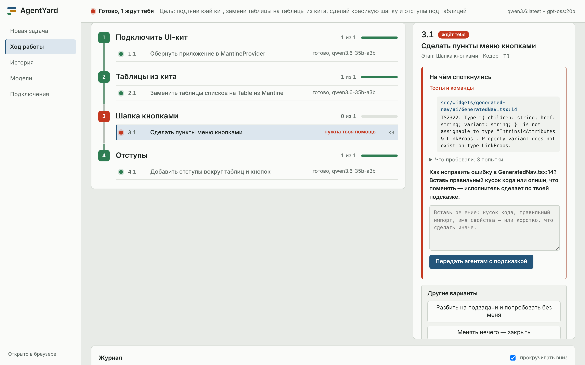
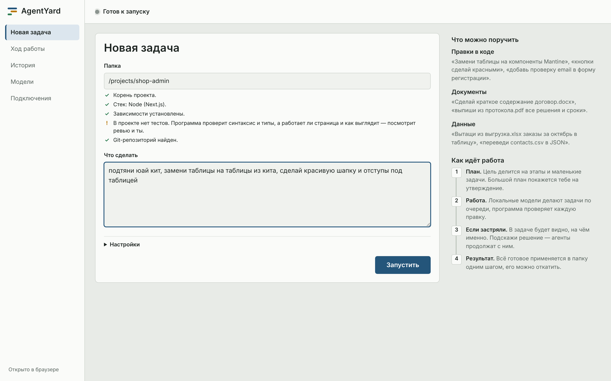
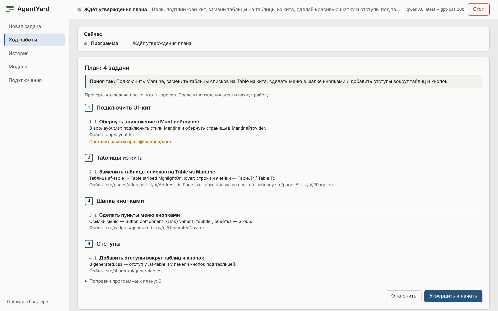
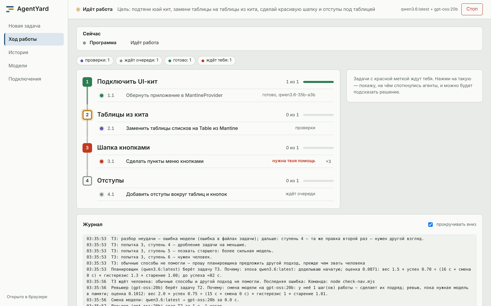
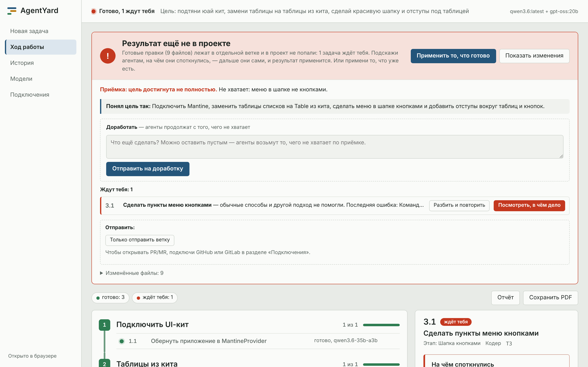
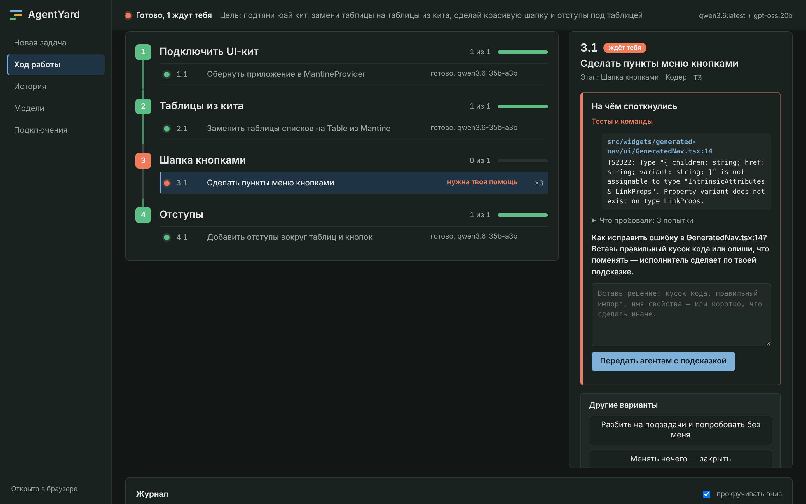
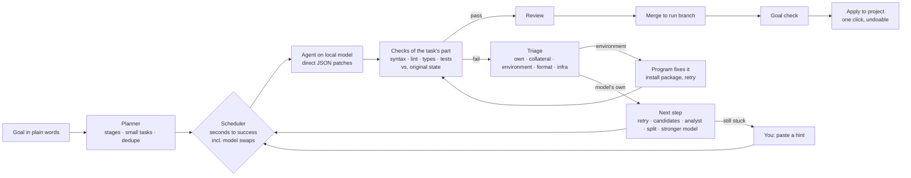

# AgentYard

**A local-first orchestrator for AI coding agents on open-weight models.**
Give it a folder and a goal written the way you'd say it out loud. AgentYard plans the work in stages, runs small agents on your own GPU through [Ollama](https://ollama.com), checks every edit with real tools (type checker, tests, linters), and shows you exactly where it got stuck when it does — so you can paste a hint and let it continue.

No cloud, no API keys, no telemetry. Your code never leaves the machine.

[Русская версия](README.md)

    



> The interface is in Russian. The screenshots come from a demo project with a scripted model; on Windows the UI uses Bahnschrift and Segoe UI.

## Why

Small local models (7–35B) can write code, but left alone in a real project they fail in predictable ways. They wander, repeat the same broken patch, and blame the project for failures they didn't cause. Then they hand you a pile of output instead of a clear question.

AgentYard is the scaffolding that makes them useful. The program does everything that doesn't need a model: it finds where the change goes, repeats one solution across many similar files, runs the checks, and decides whose fault a failure is. The models only get small, concrete steps.

## What it does

- **Plans in stages you can read.** A sloppy goal like «подтяни юай кит, замени таблицы, сделай красивую шапку» becomes three to five named stages with small tasks. Duplicate tasks are merged. Large plans wait for your approval.
- **Checks every edit for real.** Syntax, linter, type checker and tests run on each change. The checks belong to the part of the project the files live in, so a `web/` task is never judged by the Go tests in `backend/`.
- **Blames only new failures.** If a command was already red before the run, AgentYard runs it once on the original code and compares failures key by key. A task fails only for what it broke.
- **Works out whose failure it is.** Before retrying, it classifies the failure:
  - a missing package is installed by the program, without spending an attempt;
  - an Ollama hiccup is retried for free;
  - a model that is converging keeps its turn;
  - a model repeating the same patch gets a second opinion right away.
- **Asks for help precisely.** When a task gets stuck, its panel shows the check that failed, the exact errors with file and line, and what was already tried. You paste a fix or a hint, and the agents continue with it.
- **Treats GPU swaps as a cost.** Loading another model takes 7–20 s. The scheduler compares expected seconds to success, splits the load time across all the steps a model will do while loaded, and only interrupts a model's batch when waiting would cost more.
- **Repeats one solution across similar files.** When the same edit is needed in 15 list pages, a model makes it once. The program learns the edit as rules and replays it everywhere else, and only the files where it doesn't fit go back to a model.
- **Handles documents and data too.** It reads docx, xlsx, pptx, html, csv, json and text-based PDFs for you. A summary of a 200-page report is split into parts and merged back. Results go to `out/` and are checked for format.
- **Keeps your project safe.** All work happens on a separate git branch. You apply the result in one click and can undo it. When a run ends, its models are unloaded from VRAM.

## Screenshots

| | |
|---|---|
|  **New task:** a folder, a goal in plain words, and a readiness check of what can be verified. |  **Plan:** how the goal was understood, stages and tasks, packages to install. |
|  **Live run:** stages as stations on one track, what each model is doing right now, the journal. |  **Result:** the goal check, what's ready, what needs you, and one-click apply. |
|  **Dark theme**, with the panel for a stuck task. |  **Where it got stuck:** the error with file and line, what was tried, and a field for your fix. |

## How it works



The details are in [docs/ENGINE.md](docs/ENGINE.md) (orchestration engine) and [docs/ALGORITHM.md](docs/ALGORITHM.md) (decomposition, pools, conveyor).

## Honest limits

- Local models are much weaker than frontier cloud models at multi-file reasoning, library type puzzles and vague goals. AgentYard does well on narrow edits, repetitive changes across many files, documents and data. It will not build a feature from «make it pretty» on its own. It gets stuck less often, and when it does, it shows you exactly where.
- One run at a time and one GPU. Tested on Windows with an RTX 5080 (16 GB) running `qwen3.6` and `gpt-oss:20b`.
- PDF text extraction is best-effort. Scans need OCR first.

## Quick start (Windows)

You need:

| What | Why |
|---|---|
| [Node.js](https://nodejs.org) 22.6+ | runs the TypeScript sources directly, no build step |
| git | run branches, task worktrees, undo |
| [Ollama](https://ollama.com) | runs the models |

```bat
git clone <this repo> agentyard
cd agentyard
start-app.bat        :: desktop window (installs Electron once, ~100 MB)
start-ui.bat         :: or the same interface in your browser
```

See what fits your GPU and pull models:

```bat
ay hw
ay models
ay models pull qwen3.6
```

Command line, without the UI:

```bat
ay run --repo C:\path\to\project --goal "add CSV export of the orders report"
```

There are no runtime dependencies. Electron is only needed for the desktop window, and TypeScript only for `npm run typecheck`.

## Project layout

| Path | What |
|---|---|
| `src/engine/` | Orchestration engine: project parts, baseline comparison, triage, policy, swap-aware scheduling, document extraction, «where it got stuck» |
| `src/pipeline.ts` | Main loop: lanes, escalation ladder, merges, human hand-off |
| `src/conveyor.ts`, `src/dispatcher.ts` | Task order, model epochs, scoring |
| `src/plan.ts`, `src/planner.ts` | Plan validation, stages, merging duplicates, splitting |
| `src/pools.ts`, `src/rules.ts` | Similar-task pools and replaying one solution |
| `src/checks.ts` | Check cascade |
| `src/agent.ts`, `skills/` | Agent prompts, roles, recipes, the learned-solutions notebook |
| `src/runtime/` | Ollama adapter (streaming, abortable) and a scripted model for tests |
| `src/server.ts`, `ui/` | Local API and the interface (plain JS, no framework) |
| `electron/` | Desktop shell |
| `test/` | 184 tests, including replays of real failed runs |

## Tests

```bat
npm test
```

The suite covers the engine module by module and replays real runs that once went wrong. One example: a Go + Next.js monorepo whose backend tests were red before the run.

## License

Proprietary, all rights reserved. The source is published for viewing only: using, copying, modifying or distributing it requires written permission from the author. See [LICENSE](LICENSE).
