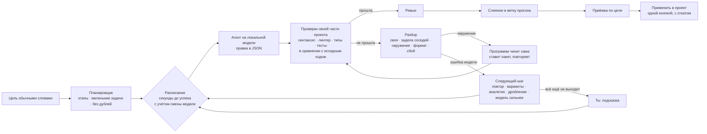

# AgentYard

**Локальный оркестратор ИИ-агентов на открытых моделях.**
Указываешь папку и пишешь цель обычными словами. AgentYard сам разбивает работу на этапы и гоняет небольшие модели на твоей видеокарте через [Ollama](https://ollama.com). Каждую правку он проверяет настоящими инструментами: типами, тестами, линтером. Если агенты застряли, видно, на чём именно: подсказываешь решение, и работа идёт дальше.

Без облака, без ключей API, без телеметрии. Код не покидает компьютер.

[English version](README.en.md)

    


> Скриншоты сняты на учебном проекте с заготовленными ответами модели. В Windows заголовки набраны шрифтом Bahnschrift, текст — Segoe UI.

## Зачем

Небольшие локальные модели (7–35B) умеют писать код, но в настоящем проекте без присмотра ошибаются одинаково. Бродят по файлам, по кругу присылают одну и ту же неверную правку, путают свои ошибки со старыми ошибками проекта. В итоге отдают человеку простыню вывода вместо понятного вопроса.

AgentYard — обвязка, которая делает их полезными. Всё, что можно без модели, делает программа: находит место правки, повторяет одно решение во всех однотипных файлах, запускает проверки, разбирает, чья неудача. Моделям достаются маленькие конкретные шаги.

## Что умеет

- **Понятный план.** Цель вроде «подтяни юай кит, замени таблицы, сделай красивую шапку» превращается в 3–5 названных этапов с маленькими задачами. Одинаковые задачи склеиваются. Большой план ждёт твоего утверждения.
- **Настоящие проверки.** Каждую правку проверяют синтаксис, линтер, типы и тесты той части проекта, где лежат её файлы. Задачу про `web/` не судят тестами бэкенда на Go.
- **Задача отвечает только за новые ошибки.** Если проверка была красной ещё до прогона, программа один раз запускает её на исходном коде и сравнивает падения.
- **Разбор неудачи перед повтором.** Программа сначала выясняет, чья ошибка:
  - нет пакета — программа ставит его сама, попытка не тратится;
  - Ollama сбоила — повтор без траты попытки;
  - модель сходится — остаётся на той же ступени;
  - модель прислала ту же правку второй раз — сразу подключается аналитик.
- **«На чём споткнулись».** В панели задачи видно, на какой проверке остановились, какие ошибки (файл и строка) и что уже пробовали. Вставляешь решение или подсказку — агенты продолжают с ней.
- **Смена модели — это цена.** Загрузить другую модель — 7–20 секунд. Планировщик считает, сколько секунд в среднем уйдёт до успеха. Время загрузки делится на все шаги, которые модель сделает подряд. Модель прерывают ради другой, только если ждать дороже.
- **Одно решение — во все однотипные файлы.** Если одна и та же правка нужна в 15 страницах, модель делает её один раз. Программа выводит из неё правила и повторяет в остальных файлах; туда, где правило не подошло, снова идёт модель.
- **Документы и данные.** Программа сама читает docx, xlsx, pptx, html, csv, json и PDF, если в нём есть текст. Большой документ режется на части и собирается в итог. Результат кладётся в `out/` и проверяется по формату.
- **Проект в безопасности.** Работа идёт в отдельной git-ветке. Результат применяется одной кнопкой и откатывается. В конце прогона модели выгружаются из видеопамяти.

## Скриншоты

| | |
|---|---|
|  **Новая задача:** папка, цель обычными словами и проверка, чем программа сможет проверять работу. |  **План:** как понята цель, этапы и задачи, какие пакеты поставит. |
|  **Ход работы:** этапы на одной линии, что каждая модель делает прямо сейчас, журнал. |  **Результат:** приёмка по цели, что готово, что ждёт тебя, применение в проект одной кнопкой. |
|  **Тёмная тема** и панель застрявшей задачи. |  **На чём споткнулись:** ошибка с файлом и строкой, что пробовали, поле для подсказки. |

## Как устроено



Подробно: [docs/ENGINE.md](docs/ENGINE.md) — движок оркестрации, [docs/ALGORITHM.md](docs/ALGORITHM.md) — декомпозиция, пулы, конвейер, [docs/GUIDE.ru.md](docs/GUIDE.ru.md) — команды, файлы прогона, что где в коде.

## Честные ограничения

- Локальные модели заметно слабее облачных там, где нужно думать сразу о нескольких файлах, разбираться в типах библиотек и понимать размытую цель. AgentYard хорош на точечных правках, однотипных изменениях по многим файлам, документах и данных. Сложную разработку по фразе «сделай красиво» он сам не вытянет. Но застревает реже, а когда застревает, показывает, где именно.
- Один прогон за раз, одна видеокарта. Проверено в Windows на RTX 5080 (16 ГБ) с `qwen3.6` и `gpt-oss:20b`.
- Текст из PDF — по возможности: из скана сначала нужно распознать текст.

## Быстрый старт (Windows)

| Что | Зачем |
|---|---|
| [Node.js](https://nodejs.org) 22.6+ | запускает TypeScript напрямую, без сборки |
| git | ветки прогонов, рабочие копии задач, откат |
| [Ollama](https://ollama.com) | запускает модели |

```bat
git clone <адрес репозитория> agentyard
cd agentyard
start-app.bat        :: окно приложения (один раз поставит Electron, ~100 МБ)
start-ui.bat         :: или тот же интерфейс в браузере
```

Что влезет в видеокарту и как скачать модели:

```bat
ay hw
ay models
ay models pull qwen3.6
```

Без интерфейса, из командной строки:

```bat
ay run --repo C:\путь\к\проекту --goal "добавь экспорт отчёта по заказам в CSV"
```

Сторонних пакетов для работы нет. Electron нужен только для окна приложения, TypeScript — только для `npm run typecheck`.

## Что где в коде

| Папка | Что там |
|---|---|
| `src/engine/` | Движок: части проекта, сравнение с исходным кодом, разбор неудач, выбор следующего шага, расписание с учётом смены моделей, чтение документов, «на чём споткнулись» |
| `src/pipeline.ts` | Главный цикл: лестница эскалации, слияния, передача человеку |
| `src/conveyor.ts`, `src/dispatcher.ts` | Порядок задач, эпохи моделей, оценка «шаг + модель» |
| `src/plan.ts`, `src/planner.ts` | Проверка плана, этапы, склейка дублей, дробление |
| `src/pools.ts`, `src/rules.ts` | Однотипные задачи и повтор одного решения |
| `src/checks.ts` | Каскад проверок |
| `src/agent.ts`, `skills/` | Подсказки агентам, роли, рецепты, тетрадь найденных решений |
| `src/runtime/` | Ollama (поток, обрыв по «Стопу») и учебная модель для тестов |
| `src/server.ts`, `ui/` | Локальный сервер и интерфейс (обычный JS, без фреймворков) |
| `electron/` | Оболочка приложения |
| `test/` | 184 теста, в том числе повторы настоящих неудачных прогонов |

## Тесты

```bat
npm test
```

Движок проверяется по модулям, а настоящие неудачные прогоны повторяются целиком. Например, монорепо Go + Next.js, где тесты бэкенда были красными ещё до прогона.

## Лицензия

Закрытая лицензия, все права защищены. Код открыт только для просмотра: использовать, копировать, изменять и распространять его без письменного разрешения автора нельзя. Подробно — в [LICENSE](LICENSE).
